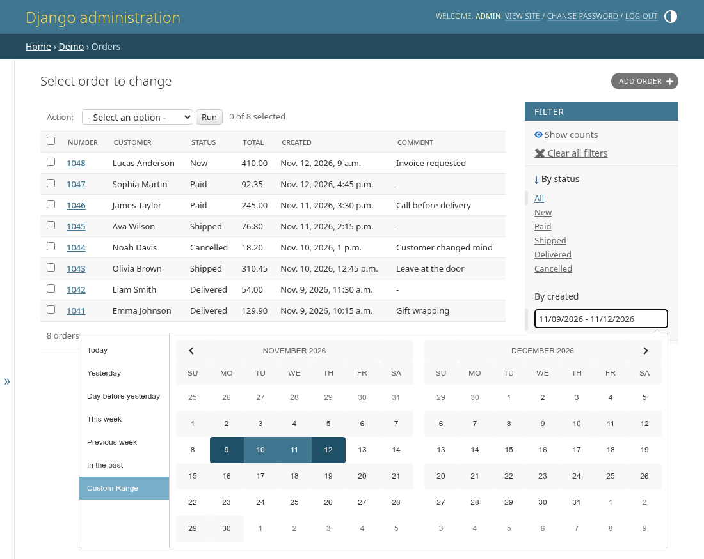

# Django admin date range filter

[](https://github.com/andreynovikov/django-daterangefilter/actions/workflows/test.yaml)
[](https://github.com/andreynovikov/django-daterangefilter/releases/latest)
[](https://pypi.org/project/django-daterangefilter/)
[](https://pypi.org/project/django-daterangefilter/)
[](https://github.com/andreynovikov/django-daterangefilter/issues)
[](LICENSE)

Application adds three Django admin list filters: ```DateRangeFilter```, ```PastDateRangeFilter``` and ```FutureDateRangeFilter```. These filters let user filter models by date range. ```PastDateRangeFilter``` and ```FutureDateRangeFilter``` add quick selection of predefined date ranges. Filters can be applied to any model date fields. Application supports default Django admin theme and [Suit theme](https://github.com/darklow/django-suit).



## Requirements

* Python 3.10+
* Django 5.2+ (5.2, 6.0 and 6.1 are tested)

## Installation

Install ```django-daterangefilter``` using pip:

```shell
pip install django-daterangefilter
```

Add ```daterangefilter``` to ```INSTALLED_APPS```. Example:

```python
INSTALLED_APPS = (
    ...
    'daterangefilter',
    ...
)
```

Application uses static files so do not forget to issue ```collectstatic``` management command in production environment.

## Example usage

in admin.py:

```python
from django.contrib import admin
from daterangefilter.filters import PastDateRangeFilter, FutureDateRangeFilter

@admin.register(Post)
class PostAdmin(admin.ModelAdmin):
    list_filter = [
        ('created_at', PastDateRangeFilter), ('publish_at', FutureDateRangeFilter)
    ]
```

## Advanced usage

Predefined ranges can be completely redefined by overriding ```_past_ranges.html``` and ```_future_ranges.html``` templates.
Take into account that these templates are inserted in the middle of the javascript code and may contain nothing but ranges
definition. For more examples on using ```moment``` library refer to [library documentation](https://momentjs.com/docs/#/manipulating/).

## Development

Tests are run with [tox](https://tox.wiki/) against all supported Python and Django versions:

```shell
pip install tox
tox                             # all available Python versions
tox -e py313-django61           # particular environment
python runtests.py              # current virtual environment
```

To release a new version, update ```version``` in ```pyproject.toml```, commit the change and push a tag
with the same version:

```shell
git tag v1.3
git push origin v1.3
```

GitHub workflow runs the tests, publishes the package to TestPyPI and PyPI and creates GitHub release.

## Credits

Filter widget uses a great JavaScript date range picker component - [Date Range Picker](https://github.com/dangrossman/daterangepicker) by Dan Grossman.
